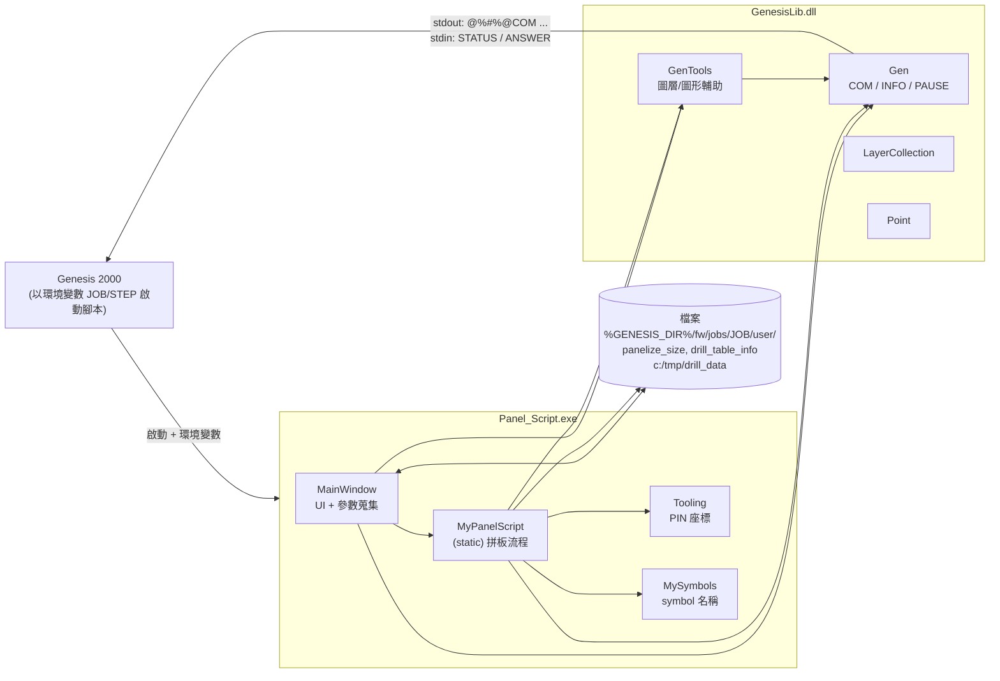
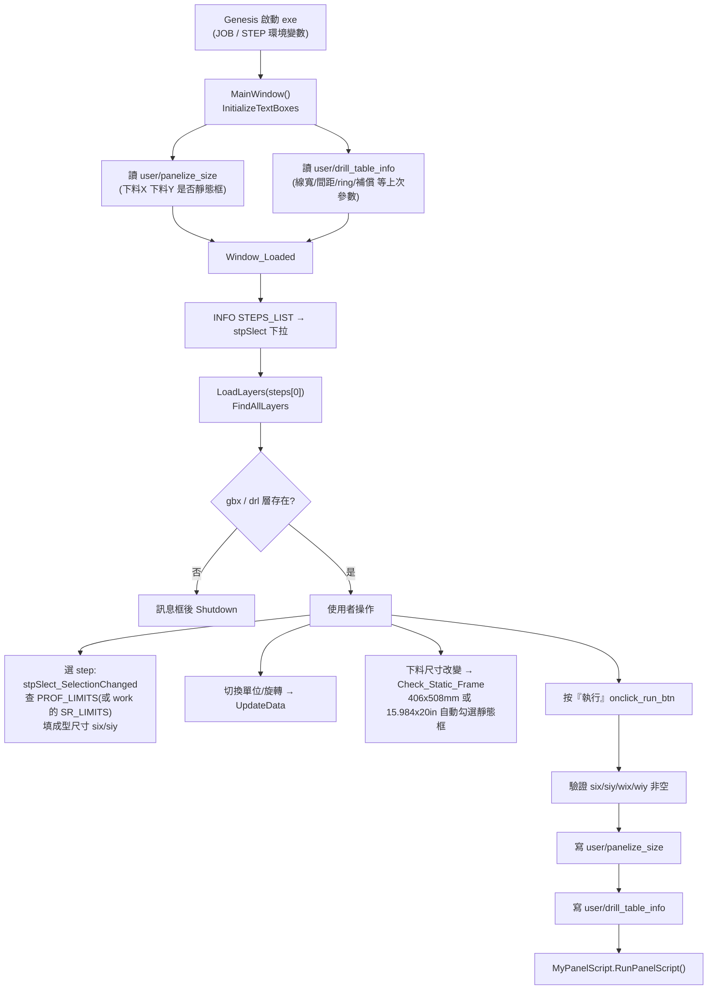
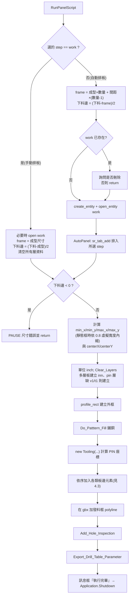

# ezCam / Panel_Script 架構與運作導覽

> 範圍:`Panel_Script/`、`MyLib/GenesisLib/`、`Panel_Script/loc/` 圖片。
> 不含 `.vshistory/`、`*_bak`、`bin/`、`obj/`、`packages/`。
> 標記 **〔推測〕** 的內容是依命名與上下文推論,未經業務面確認,彙整於文末「待確認清單」。

---

## 1. 一句話概述

`Panel_Script` 是一支被 **Genesis 2000(PCB CAM 軟體)** 當作外部腳本啟動的 WPF 程式。
使用者在視窗輸入成型尺寸、下料尺寸、排板數量等參數後,程式在 Genesis 內建立(或沿用)名為 `work` 的 step,
並透過 `GenesisLib` 對 Genesis 下達大量指令,自動在板邊加上工具孔、光學點、標記、字樣、鋪銅等工作板(panel)元素。

## 2. 專案組成

| 專案 | 型別 | 框架 | 行數(約) | 職責 |
|---|---|---|---|---|
| `Panel_Script` | WPF Exe | .NET Framework 4.0 Client Profile | 4300 | UI 與拼板邏輯 |
| `MyLib/GenesisLib` | Class Library | .NET Framework 3.5(`GenesisLib.csproj`) | 730 | 與 Genesis 溝通的薄層封裝 |
| `packages/ILMerge` | NuGet 套件 | — | — | `Panel_Script.csproj` 有匯入 ILMerge.props 〔推測:用來把 GenesisLib.dll 合併進單一 exe〕 |

`Panel_Script` 內的檔案:

| 檔案 | 行數 | 內容 |
|---|---|---|
| `MainWindow.xaml(.cs)` | 1209 | 視窗;含三個分頁「排板設定」「層別預覽」「HDI壓合參數」,以及 ViewModel 類別 |
| `MyPanelScript.cs` | 2695 | `static class MyPanelScript`,所有拼板工作的實作 |
| `Tooling.cs` | 124 | 計算印刷 PIN 座標的類別 `Tooling` |
| `Symbols.cs` | 141 | `struct MySymbols`,集中管理 Genesis symbol 名稱字串 |
| `App.xaml(.cs)` | 16 | 空殼 Application |

## 3. 整體架構

### 3.1 與 Genesis 的通訊協定(`Gen` 類別)

`GenesisInterface.cs` 的 `Gen` 實作 Genesis 外部腳本的標準協定:

- 以 `Console.WriteLine("@%#%@COM <指令>")` 輸出指令(`@%#%@` 為 `Header`)。
- 接著從 `Console.ReadLine()` 依序讀兩行:`STATUS`、`COMANS`。
- `COM` 在 `STATUS != "0"` 且未處於 `VOF`(關閉錯誤中止)時,直接 `Environment.Exit(0)`。
- `INFO(args)`:呼叫 Genesis 的 `info` 指令,輸出到 `$GENESIS_TMP/LRT_<隨機數>`,讀回檔案後用 Regex `^set\s*(\S+)\s*=\s*(.*?)$` 解析成 `Dictionary<string, object[]>`,再由 `GetInfo("gXXX")` 取值。
- 其他:`PAUSE`(跳出訊息框,回覆非 `OK` 就結束)、`MOUSE`、`AUX`、`VOF/VON`、`SU_ON/SU_OFF`。
- `Gen.JOB` / `Gen.STEP` 於載入時由環境變數 `JOB` / `STEP` 讀取。

因此這支程式必須**由 Genesis 啟動**才能運作,且 `Console` 的 stdin/stdout 被協定佔用。

### 3.2 GenesisLib 其他元件

| 類別 | 職責 |
|---|---|
| `GenTools` | `GEN_DIR`(`GENESIS_DIR` 環境變數)、圖層型態字典 `layerType`、`POS_NEG`、`Clear_Layers`、`Layer_IsExist`、`Layer_Create`、`Find_Layer`、`Add_Line`、`Add_Rec_Line`、`FindAllLayers`、`DoubleRound`(四捨五入到 6 位) |
| `LayerCollection` | 純資料容器:`SignalLayers`、`Outer`、`Inner`、`InnerList`、`SignalEmpty`、`SolderMask`、`SilkScreen`、`Drill`、`BlindDrill`、`Via`、`Tent`、`SmssList`、`Full_Layer_Side`(層名→top/bottom) |
| `Point` | 座標與邊界;`CenterPoint()` 會對 `work` step 查 `PROF_LIMITS` 算中心點 |

### 3.3 層別分類規則(`GenTools.FindAllLayers`)

對 step 內每個 `context == board` 的層,依 `BASE_TYPE` 分類:

| BASE_TYPE | 歸入 |
|---|---|
| `signal` / `mixed` / `power_ground` | 層名含 `e` → `SignalEmpty`;否則 `SignalLayers`。兩者都記入 `InnerList` 與 `Full_Layer_Side` |
| `solder_mask` | `SolderMask` 與 `SmssList` |
| `silk_screen` | `SilkScreen` 與 `SmssList` |
| `drill` | 層名含 `-` 或 `_` → `BlindDrill`;否則 `Drill` |

之後:

1. 檢查 `v1`、`t1` 是否存在,存在則加入 `Via`/`Tent`。
2. 取 `job[7]` 這個字元當作層數代碼:數字且非 `1` → 檢查 `v{n}`、`t{n}`;字母 → `(ch-'a')*2+10` 換算成層數(程式註解列出 a=10、b=12 … k=30)。**〔推測:job 命名慣例的第 8 個字元表示層數〕**
3. `InnerList` 移除第一與最後一項。
4. `SignalLayers` 的第一與最後一層成為 `Outer`,中間成為 `Inner`。

## 4. 執行流程

### 4.1 UI 階段(`MainWindow`)

### 4.2 拼板主流程(`MyPanelScript.RunPanelScript`)

### 4.3 板邊元素加入順序與職責

下表依 `RunPanelScript` 實際呼叫順序整理。座標基準皆為 `min_x/min_y/max_x/max_y`(英吋)。
「業務意義」欄的描述大多來自程式註解與 `Symbols.cs`,仍標示 **〔推測〕** 處為我的詮釋。

| # | 方法 | 作用(程式面事實) | 業務意義 |
|---|---|---|---|
| 1 | `Do_Patttern_Fill` | 內層以 `Layer_Pattern_Fill` 鋪銅(`sr_fill`);外層依「正片/負片」選項用不同邊距與 trim 線寬;在中心放 CCD 框 symbol(內層奇偶交替 `inner_frame_1/2`,外層 `ccd_frame_p/n`);多層或負片時建立暫存層 `ccd_coooper_fill` 填 CCD 區域銅再複製到各層;多層板最後呼叫 `Add_Inner_Strip` | 板邊鋪銅與 CCD 對位框〔推測〕 |
| 2 | `Add_Pin_pad(OUTTER)` | 在外層(及無內層時的 SignalEmpty 層)依 `Tooling.PrintPinOuterX/Y` 加 PIN pad;索引在 `Ccd_Pad_Loc = {2,4,5,8}` 者用 `pnl_pin_ccd_pad_p/n`,其餘用 `pnl_out_pin_pad` | 外層印刷 PIN |
| 3 | `Add_L_Mark` | 板角 L 型標記(`pnl_l_mark`、`_n`) | L Mark |
| 4 | `Add_SM_CCD` | 防焊 CCD 孔 + pad(`pnl_ccd_sm_fid`) | 防焊對位光學點 |
| 5 | `Add_Slice_Hole` | 外層與內層各加切片孔 pad(`pnl_mic_n`、`pnl_mic_inn`),位置在左下與右上 | 切片孔 |
| 6 | `Add_Pin_pad(SMSSTENTVIA)` | 在防焊/文字、via、tent 層加 `donut_r180x150` | 對位 PIN |
| 7 | `Add_Pin_pad(INNER)` | 內層加 `pnl_inn_pin_pad_n/p`,並在 `inn` 層加 `r125` 孔 | 內層 PIN 與孔 |
| 8 | `Add_Pin_pad(DRLINNGBX)` | 在 `drl`、`gbx` 加 `r125` 孔 | 鑽孔 PIN |
| 9 | `Add_CCD_Fid_Pad` | 防焊 CCD 光學點 PAD | — |
| 10 | `Add_PN_DC` | 板邊加料號與日期字樣(`$$JOB ... $$DATE-MMDDYY`),依層別型態分支處理 | 廠內料號/週期標示 |
| 11 | `Add_Layer_Frame` | 逐一訊號層加層別顯示框與名稱 | 層別辨識 |
| 12 | `Add_Ten_Pad` | 外層十字型 pad(`pnl_ten_pad`) | — |
| 13 | `Add_Tenting_Text` | 外層負片字樣 | tenting 流程 |
| 14 | `Add_Donut_Lyr_Reg` / `Add_Target_Hole` / `Add_Inn_Hole` | 僅在有內層時執行:層間對準 donut、靶孔、INN 孔/pad(沿邊每 2.5 吋一個) | 內層對位 |
| 15 | `Add_Mount_Hole` | 訊號層 ≥ 6 或勾選 `need_mount_hole` 時加鉚釘孔 | 鉚釘孔 |
| 16 | `Add_Special_Symbols` | 最小防焊橋 symbol 與數值、防焊 CCD 框、Date Code(依所選層與 YYWW/WWYY)、負擋/塞孔片 symbol(C/S 面) | 板邊特殊標示 |
| 17 | `Add_Scale_Text` | via 層與 silk 層加固定字串漲縮值(`X:0.9992 Y:0.9996`、`X:0.9996 Y:0.9997`) | 補償字樣 |
| 18 | `Add_Hole_Inspection` | 暫存 `find_drill_size_` 層攤平 `drl`,裁掉下料邊的孔,刪負片與線段,用 `info FEATURES` 解析孔徑集合,逐一加斷針檢驗孔;依最小孔徑加切片孔與對應 pad、最小線寬線段 | 斷針檢驗孔、切片孔 |
| 19 | `Export_Drill_Table_Parameter` | 以 `disp_snapshot` 輸出 jpg 到 `c:/tmp/drill_data`,並把 `drill_table_info` 複製成 `{Job}.exceltmpvarfile` | 供 Excel 孔表使用〔推測〕 |

`Add_Inner_Strip`(由 `Do_Patttern_Fill` 呼叫,多層板才執行)在暫存層以 surface 畫出左右、上下的斜邊條,鏡射後複製到 `ccd_strip_tmp_1/2`,再依內層奇偶交替複製到各內層,最後刪暫存層。註解寫「strip rule-4x each long side, 2x each short side」。**〔推測:流膠條/導流條〕**。

### 4.4 座標系統(對照 `loc/map.png`)

`map.png` 的標示:

- 原點 `(0,0)` 在成型區左下角。
- `PX`/`PY` 為成型(排板後)尺寸;`BX`/`BY` 為下料尺寸;`SX`/`SY` 為下料邊。
- 外框四角為 `(-SX, -SY)`、`(PX+SX, BY-SY)` 等。
- 圖右側的表格列出鉚釘孔座標,如 `-.35, -sy+1.5`、`px+.35, py/2-0.5`,與 `Add_Mount_Hole`、`Tooling.png` 的對應表一致。
- `tooling.png` 列出靶孔座標 `(1.2, -.3)`、`(px-1.2, -.3)`、`(1.2, py+.3)`、`(px-2.2, py+.3)`,與 `Add_Target_Hole` 中的 `min_x+1.2`、`max_x-1.2`、`min_x+1.2`、`max_x-2.2`、`min_y-0.3`、`max_y+0.3` 吻合。
- `strip.png` 列出流膠條座標(如 `2.6, -sy-.05`、`px+sx+.05, 6`),對應 `Add_Inner_Strip` 的 `Min_x + 2.6`、`Min_y + 6` 等。

這三張圖看起來是舊版腳本(Genesis 內建 symbol 表格)的座標規格,現行 C# 程式是將這些座標以程式碼重現。**〔推測〕**

### 4.5 `Tooling` 的 PIN 座標

建構子 `Tooling(layerCount, min_x, min_y, max_x, max_y, offset_x, offset_y)`:

- `Mult_lyr = layerCount > 2 ? 0.1 : 0`,多層板的水平 PIN 在 Y 方向再外推 0.1 吋。
- `printPin_outer_x/y`:共 21 組座標,註解分區為「左下H、右下H、左上H、右上H、左上V、右上V、左下V、右下V」及最後幾點。
- `printPin_inner_x/y`:取外層前 9 點(水平那排)再加減 `offset`。
- 目前呼叫端傳入的 `offset` 皆為 `0, 0`(`MyPanelScript.cs:280`),因此內層 PIN 座標與外層前 9 點相同。

### 4.6 HDI 分頁

`MainWindow.xaml.cs` 內的 `HDIControlViewModel`、`BlindVia`、`LaminationParameter` 負責「HDI壓合參數」分頁(盲孔與壓合次數的關聯)。

- 「儲存」按鈕 `SaveHDISettings_Click` 目前只跳訊息框,沒有儲存邏輯。
- `MyPanelScript` 唯一用到的 HDI 資料是 `laminationParametersDataGrid.Items.Count`(約 `MyPanelScript.cs:1679`,於 `Add_PN_DC` 的「內層」分支),用來判斷壓合次數是否為 1;該處上方有 `//TODO: HDI板需調整`。

## 5. 資料與檔案介面

| 位置 | 讀/寫 | 內容 |
|---|---|---|
| `%GENESIS_DIR%/fw/jobs/{JOB}/user/panelize_size` | 讀(啟動)、寫(按執行) | `下料X 下料Y 是否靜態框`(單位 inch) |
| `%GENESIS_DIR%/fw/jobs/{JOB}/user/drill_table_info` | 讀(啟動)、寫(按執行)、複製(結束) | `set key = value` 格式:`cu_thkness`、`xstep_spec`、`ystep_spec`、`org_sig/space/ring`、`compensate_sig/space/ring`、`inn_org_*`、`inn_compensate_*` |
| `c:/tmp/drill_data/{JOB}.jpg` | 寫 | 板面快照 |
| `c:/tmp/drill_data/{JOB}.exceltmpvarfile` | 寫 | `drill_table_info` 的複本 |
| `C:/tmp/info_drill_list_v0.tmp` | 寫後讀後刪 | `Add_Hole_Inspection` 的 info 輸出 |
| `$GENESIS_TMP/LRT_*` | 寫後讀後刪 | `Gen.INFO` 暫存 |

## 6. 觀察備忘(僅事實,不評價)

**狀態與初始化**
- `MyPanelScript` 為 `static class`,所有尺寸狀態都是 static 欄位。(`MyPanelScript.cs:11`、`:30-58`)
- 靜態建構子 `MyPanelScript()` 直接讀取 `Application.Current.MainWindow` 的 TextBox。(`MyPanelScript.cs:88-102`)
- `layers` 與 `LayerCount` 是 `static readonly`,類別首次存取時以 `MainWindow.layers` 初始化。(`MyPanelScript.cs:32-33`)
- `s_ix` 為 `readonly` 且只在靜態建構子賦值;`s_iy` 等為可變欄位。(`MyPanelScript.cs:37-38`)
- 靜態建構子只執行一次,同一程序內若使用者更改 `six`/`wix` 等欄位,`Six`/`Wix` 不會更新(程式結束於 `Application.Shutdown()`,實務上可能每次都重啟;**〔推測〕**)。

**單位換算**
- `MyPanelScript` 靜態建構子用 `0.03937` 把 mm 換成 inch。(`MyPanelScript.cs:93`)
- `MainWindow` 用 `25.4`。(`MainWindow.xaml.cs:882`、`:1013`)
- `Check_Static_Frame` 在 Inch 分支對 `wix` 取 3 位、對 `wiy` 取 0 位小數。(`MainWindow.xaml.cs:1122-1123`)

**GenesisLib**
- `GenTools.GEN_DIR` 的後備環境變數名稱字串為 `"EZCAM_DIR);"`(含 `);`)。(`GenTools.cs:13`)
- `FindAllLayers` 以 `lyr.Contains("e")` 判斷空層、以 `-`/`_` 判斷盲孔、以 `job[7]` 取層數碼。(`GenTools.cs:147`、`:172`、`:205`)
- `FindAllLayers` 無條件 `InnerList.RemoveAt(0)` 與 `RemoveAt(Count-1)`;若 `InnerList` 為空會拋例外。(`GenTools.cs:229-230`)
- `Gen.INFO_P` 讀完指定檔後會 `File.Delete` 該檔;且在 `InfoVal.ContainsKey` 為真時呼叫 `InfoVal.Add`。(`GenesisInterface.cs`,`INFO_P` 方法內)
- `Gen.INFO` 以 `Random.Next(9999)` 產生暫存檔名。(`GenesisInterface.cs`)
- `Gen.INFO` 以 `Encoding.ASCII` 解碼。(`GenesisInterface.cs`)

**拼板邏輯**
- `Do_Patttern_Fill` 負片外層分支中,「`Inner.Count == 0 && SignalEmpty.Count > 0`」成立時,第二次 `Layer_Pattern_Fill` 傳入的仍是 `layers.Outer`,而正片分支傳入的是 `layers.SignalEmpty`。(`MyPanelScript.cs:2290-2297` 對照 `:2272-2279`)
- `Add_Inner_Strip` 內含寫死座標 `x_anchor=-0.3927834646,y_anchor=11.1881`。(`MyPanelScript.cs:2591`、`:2653`)
- `Do_Patttern_Fill` 內 CCD 填銅區寫死為 `x_dis=10.96`、`y_dis=12.457`。(`MyPanelScript.cs:2331-2332`)
- `Add_Special_Symbols` 內防焊 CCD 框 Y 座標含寫死的 `27.4`。(`MyPanelScript.cs:739`)
- `Add_Scale_Text` 的漲縮字串為寫死常數。(`MyPanelScript.cs:625`、`:661`)
- 作業 step 名稱 `work` 在 `MyPanelScript.cs:34` 與 `MainWindow.xaml.cs:312` 各自定義。
- `Tooling` 的 `ccd_pad(int)` 為 private 且未被呼叫。(`Tooling.cs:123`)

**路徑與建置**
- `c:/tmp/drill_data`、`C:/tmp/info_drill_list_v0.tmp` 為寫死路徑。(`MyPanelScript.cs:373`、`:444`;`MainWindow.xaml.cs:1028`)
- `Panel_Script.csproj` 對 `GenesisLib.dll` 的 `HintPath` 為 `..\..\..\..\MyLib\GenesisLib\GenesisLib\bin\Release\GenesisLib.dll`;自 `Panel_Script/` 起算會解析到 `D:\workspace\MyLib\...`,與目前 repo 內的 `ezCam\MyLib\...` 位置不同。
- 目標框架為 `v4.0` Client Profile(`Panel_Script.csproj`、`app.config`)。
- `Panel_Script.csproj` 含 `Panel_Script_TemporaryKey.pfx` 與 `ManifestCertificateThumbprint`。
- 程式碼內的 TODO:`MyPanelScript.cs:8`(固定板框納入裁板尺寸)、`:335`(銅面積計算改至輸出孔表時)、`:1673`(HDI 板需調整)。

**其他**
- `RunPanelScript` 在中途 `return`(尺寸錯誤、`work` 刪除被拒)時,不會呼叫 `Application.Shutdown()`。(`MyPanelScript.cs:139`、`:157`、`:176`)
- `Panel_Script/` 目錄有 `MyPanelScript.cs_bak`、`MainWindow .xaml_bak`、`shit_poop_icon_195108.ico_ak` 等備份檔。
- `GenTools.cs` 頂端的 `using System.CodeDom` 等引用與 `GenesisInterface.cs` 的作者註解(`By:Crazy`、2018-11-09)顯示 `Gen` 類別是引用自外部範本。

## 7. 待確認清單(〔推測〕彙整,請業務專家校對)

1. `job[7]` 是否確為「層數代碼」(數字 2–9、字母 a=10 起每級 +2)?
2. 「下料尺寸」「成型尺寸」「排板尺寸(frame)」「下料邊」與 `PROF_LIMITS` / `SR_LIMITS` 的對應是否如 4.2 所述?
3. 「靜態板框(StaticFrame)」與 406×508 mm(15.984×20 吋)是否為固定規格工作板?`static_frame_width_*=0.8` 的意義為何?
4. `SMSSTENTVIA`、`DRLINNGBX` 兩個 enum 值的製程意義(防焊+文字+塞孔+via 層 / drl+inn+gbx 層)。
5. `Add_Inner_Strip` 是否就是「流膠條」,「long side 4x、short side 2x」規則的來源?
6. `Tooling` 外層 PIN 21 個點的分區與 CCD pad 索引 `{2,4,5,8}` 的對應。
7. `drill_table_info` / `.exceltmpvarfile` 的下游 Excel 孔表流程由誰讀取?
8. `Add_Scale_Text` 的漲縮字串是否應隨 job 變動(目前為寫死)?
9. `ILMerge` 是否確用於把 `GenesisLib.dll` 合併進 exe?
10. `loc/*.png` 三張圖是否為舊腳本規格(`map.png` 底部有「製作:…」字樣,內容無法完整辨識)?
11. `Add_PN_DC` 中依 `case` 分支的各層別型態(case 4 為 inner layer 等)完整定義;本文件未逐行展開此方法(約 260 行)。
12. `Add_Mount_Hole`、`Add_Donut_Lyr_Reg`、`Add_Tenting_Text`、`Add_Layer_Frame`、`Add_CCD_Fid_Pad`、`Add_SM_CCD`、`Add_Ten_Pad`、`Add_L_Mark` 僅依註解、符號名稱與座標摘要描述,未逐行解析。

## 8. 本文件的限制

- 未在 Genesis 環境實際執行,所有行為描述來自靜態閱讀。
- 本文件未涵蓋 `.vshistory`、備份檔與建置產物。
- 行號對應撰寫時(2026-10-26)的工作樹內容。
